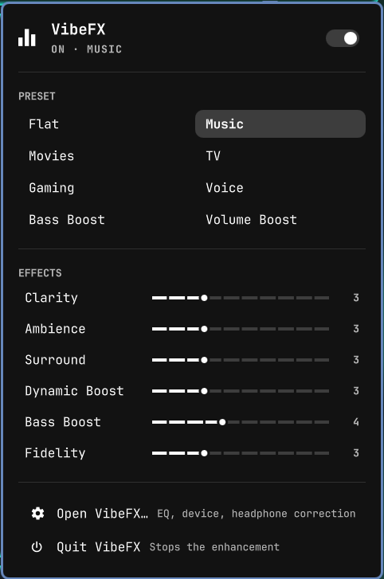

# VibeFX for Omarchy

An [Omarchy](https://omarchy.org) bar widget for
[VibeFX](https://github.com/HeyitsTayters/vibefx), the FxSound-style audio
enhancer for PipeWire. Switch effects, pick a preset and tune the effects
without opening the app.



## Install

You need [VibeFX](https://github.com/HeyitsTayters/vibefx) with `vibefx ctl`
support. On Omarchy, VibeFX's `install.sh` adds this widget for you. To add it
yourself:

```bash
omarchy plugin add https://github.com/HeyitsTayters/vibefx-omarchy.git
omarchy plugin enable dev.tayters.vibefx --before omarchy.audio
```

Update it with `omarchy plugin update dev.tayters.vibefx`.

## Use

- **Click** opens the panel: effects switch, presets, effect sliders, and
  shortcuts to open or quit VibeFX
- **Right-click** toggles effects, **middle-click** opens VibeFX,
  **scroll** cycles presets
- Keyboard: arrows move, ←/→ adjust a slider, Enter activates, `p` toggles
  effects, `o` opens the app
- When VibeFX isn't running, the panel offers to start it

Keybindings can drive it through the shell:

```bash
omarchy-shell dev.tayters.vibefx toggleEffects   # also: on, off, open, toggle
omarchy-shell dev.tayters.vibefx preset Movies
omarchy-shell dev.tayters.vibefx nextPreset      # also: previousPreset
```

## How it works

The widget runs one `vibefx ctl watch` process per bar. It prints VibeFX's
state as a JSON line on every change and takes `ctl` commands on stdin, so the
panel follows changes made anywhere (the app, its tray menu, `vibefx ctl`)
without polling. If the installed VibeFX predates `ctl`, the widget says so
instead of starting it.

## License

MIT
